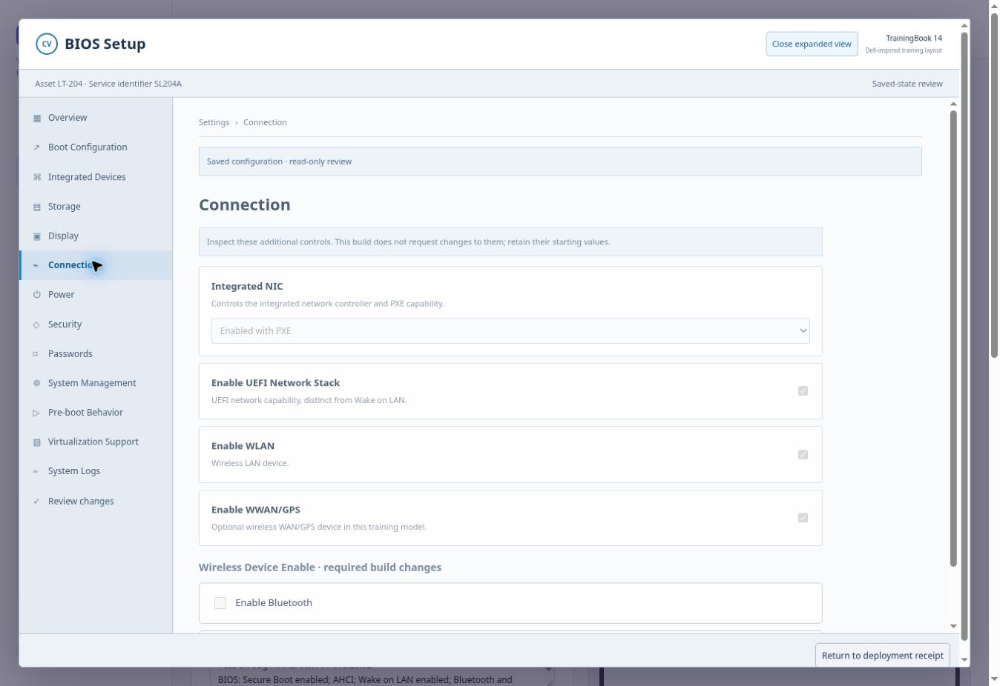

# SupportLab

**An IT Support Specialist II training experience, designed by April Walker.**

SupportLab turns everyday support work into connected lessons and guided practice. The goal is to help learners build the confidence to investigate, document, verify, and hand off real workplace tasks—not just memorize which option to select.

## Why I’m building it

Many training platforms concentrate on advanced roles. I wanted a place for learners preparing for desktop support and IT Support Specialist II work: imaging laptops, checking a completed build, working with Active Directory, mapping printers, and troubleshooting with evidence.

The curriculum follows a fictional support team at Cedar Valley Services. Requests, devices, approvals, and handoffs carry across modules so the work feels connected. All modules can be opened independently for review.

## Current prototype

- A 15-module curriculum with lessons, guided practice, and an independent capstone.
- Module 1: requester conversation, asset investigation, approval review, and learner-written ticket/handoff notes.
- Module 2: Dell-inspired BIOS navigation, MAC-address capture, boot selection, simulated imaging, application selection, and driver-failure investigation.
- Module 9: a simulated DNS console and evidence-based troubleshooting workflow.
- Browser-local progress and a continuing case record.

**This is a work in progress.** The remaining modules use early workflow prototypes. Module 5 does not yet reproduce the Active Directory Users and Computers experience closely enough; rebuilding that workspace is a planned next step.

## A look inside

### Firmware preparation and deployment practice

Students inspect settings and capture device information before proceeding through the deployment scenario. The firmware checklist is a fictional training baseline, not a universal Dell configuration recommendation.

## What is simulated

The current product uses HTML, CSS, and JavaScript. It does not run Windows, install an image, connect to Active Directory or PrinterLogic, or provision student VMs. Progress stays in the current browser through localStorage; there is no centralized student account or grading service yet. The live pilot is private.

The project uses fictional people, assets, approvals, and application bundles. It includes no employer screenshots, government-device images, or operational credentials. The BIOS interface is Dell-inspired and is not an official Dell product.

## Next steps

1. Rebuild Module 5 around a more faithful ADUC-style interface and meaningful account administration tasks.
2. Deepen the other practice workspaces and test them with learners.
3. Add student accounts, server-verified progress, and isolated Windows lab environments.
4. Prepare the finished experience for a custom domain.

The application source is maintained separately in a private repository while development continues. This public repository is the portfolio showcase.

[View the curriculum](docs/curriculum.md) · [Read the architecture notes](docs/architecture.md)
